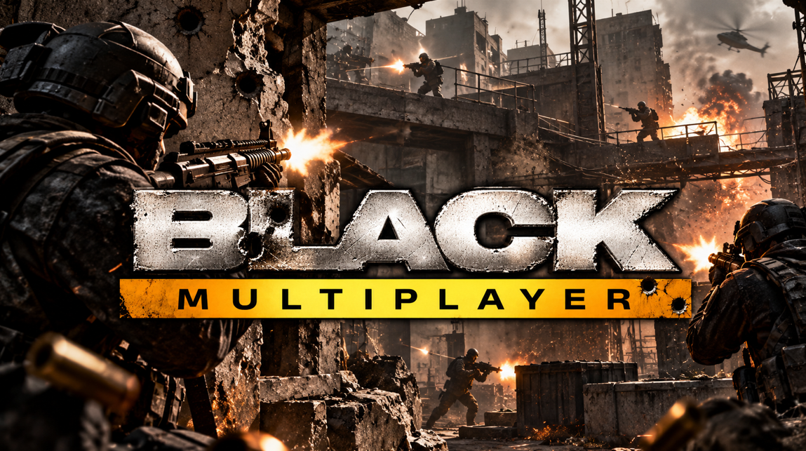
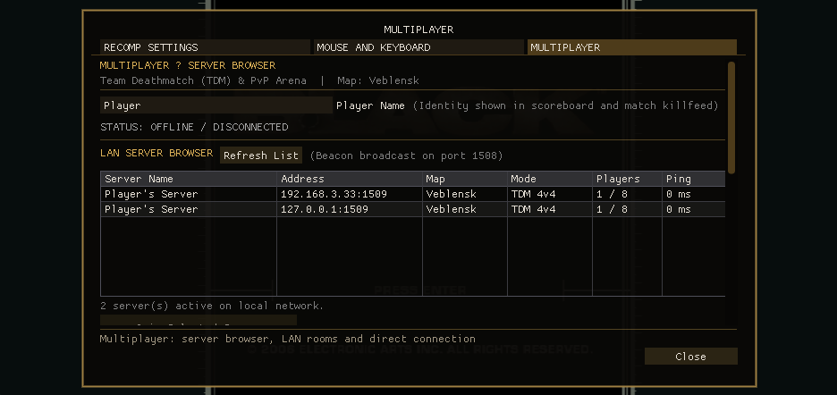
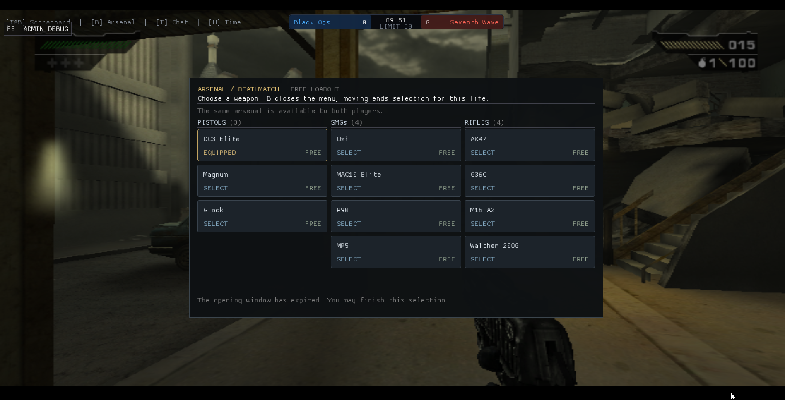
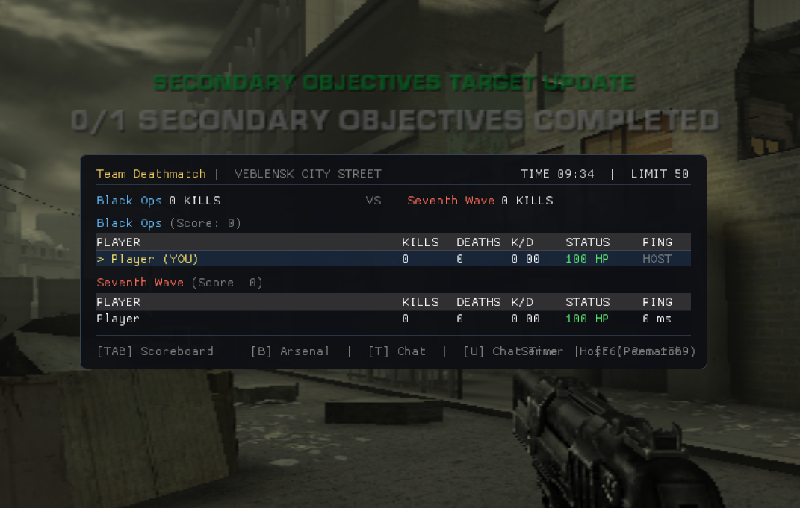

# BLACK Multiplayer — Windows Alpha Build



An experimental **Team Deathmatch multiplayer mod** for *Black* (2006, original Xbox), running natively on Windows through a static recompilation of the Xbox executable. Up to 8 players, host-or-join over LAN or direct IP, built as a mod on top of [**BLACK-XBERecomp**](https://github.com/TGP482/BLACK-XBERecomp) — the original native recompilation of *Black* that made this possible — itself built with the [XboxXBE-Recomp](https://github.com/TGP482/XboxXBE-Recomp) toolchain.

Community & support: [Discord](https://discord.gg/szt9HJYjDt) · [Sponsor this project](#support-this-project)

> [!IMPORTANT]
> **This is a binary-only alpha test build.** This repository contains a compiled `BLACK.exe` and the small helper scripts around it — **no source code**. The full source for the Windows port, including this build's exact commit, lives in the [`BLACK-Coop`](https://github.com/Peterson047/BLACK-Coop) repository, branch [`feat/windows-multiplayer`](https://github.com/Peterson047/BLACK-Coop/tree/feat/windows-multiplayer) (built from commit [`b2d998b`](https://github.com/Peterson047/BLACK-Coop/commit/b2d998b)).

## Screenshots

| Server browser | Loadout / arsenal | In-match scoreboard |
| --- | --- | --- |
|  |  |  |

## What this build adds

The base port is a faithful native recompile of *Black* — keyboard/mouse, a Vulkan renderer, adjustable resolution/FOV/draw distance, and the other options from the upstream Linux port. On top of that, this build adds:

- **Team Deathmatch**: Black Ops vs. Seventh Wave, in Veblensk, up to 8 players.
- **LAN discovery** and **direct-IP** hosting/joining, with the game and discovery ports configurable independently (see [Networking](#networking) below).
- **Dedicated servers**: join a standalone server by IP. The server takes no player slot and never appears in the match.
- A shared weapon arsenal (pistols, SMGs, rifles) selectable from an in-match loadout menu.

## Requirements

- Windows 10 or 11, 64-bit.
- A GPU with Vulkan 1.2 support (NVIDIA, AMD or Intel, with an up-to-date driver).
- **Your own legal copy of *Black***. See below.

No Python install needed — a Python runtime ships in `python\` and `BLACK.exe` uses it itself, automatically, to build the multiplayer map/arsenal from your disc image the first time it finds one.

## You need your own copy of the game

> [!NOTE]
> This project does not include any game assets. No game files ship in this repository or in this release — you must provide the files from your own legally acquired copy of *Black* (USA or Europe release, as a `.iso` disc image or already-extracted files) to play.

This is an unofficial, fan-made project with no affiliation to the original developer or publisher of *Black*.

## Setup

1. Download this build and put your own `Black.iso` (or `default.xbe` + the extracted `chars`, `data`, `export`, `language`, `levels`, `sound` and `videos` folders) inside `assets\`.
2. Run `BLACK.exe`. If it found a `Black.iso` in `assets\`, it builds the TDM map package and weapon arsenal from it automatically the first time (a few seconds, logged as `setup: building the multiplayer package...`) — no extra step needed.
3. **Host a match**:
   ```bat
   windows\host.bat [port] [name]
   ```
4. **Join a match**:
   ```bat
   windows\join.bat <host-ip> [name]
   ```
   Or use the in-game menu (`F10` → Multiplayer) for a server browser, instead of the scripts.
5. **Join a dedicated server**: `windows\join.bat <server-ip>`, or `F10` → **Connect to Server**, type `ip:port` (for example `203.0.113.10:1508`) and press **Connect**. Leave *Secure session (TLS)* closed: the identity file is only for the experimental TLS servers.

If `Black.iso` isn't in `assets\` (you used the extracted files instead), or no Python interpreter is found, multiplayer stays off until you run `windows\setup.bat` by hand — single player is unaffected either way.

Both sides of a match need to be running **the same build** — the protocol does not negotiate versions between different builds.

## Networking

Two separate UDP ports are involved, both configurable in `black.toml` (written next to `BLACK.exe` after the first run) or from the in-game Host screen:

| Setting | Default | Purpose |
| --- | --- | --- |
| `host_port` | `1508` | The actual game port — this is what the people joining you connect to. |
| `discovery_port` | `1510` | The LAN beacon/browser port, used only for "Find LAN servers" auto-discovery. |

**Keep these two different.** On Windows, two sockets can both bind the same UDP port without an error (looser `SO_REUSEADDR` semantics than Linux), which causes the host to receive and process every join packet twice. The game detects this at startup and simply disables the LAN discovery responder if the two ports match — hosting and direct-IP joining still work fine, you just lose the auto-discovery list for that session.

Firewall: on first run, Windows will prompt to allow `BLACK.exe` on private networks — accept it. For internet play (not just LAN), the host needs to forward `host_port` (UDP) on their router.

## Status

Alpha. Tested on this build: Vulkan initialization (including a fix for a swapchain synchronization bug that could corrupt textures/geometry on AMD GPUs), the automatic first-run multiplayer package build, LAN discovery, hosting, joining, and a full TDM match end to end. Joining a Linux dedicated server over the internet was tested with two clients. The TLS session server (a separate, still-experimental feature in the source project) is not part of this build; the client side is, behind the *Secure session (TLS)* option.

Found a bug? Open an issue against the source repository, [`BLACK-Coop`](https://github.com/Peterson047/BLACK-Coop), and include the relevant file from the `logs\` folder that's created next to `BLACK.exe`.

## Community

Questions, bug reports, LAN parties, looking for people to play with — join the [Discord](https://discord.gg/szt9HJYjDt).

## Credits

- [**BLACK-XBERecomp**](https://github.com/TGP482/BLACK-XBERecomp) — the original native recompilation of *Black*. This multiplayer mod, and this Windows build, would not exist without it.
- [XboxXBE-Recomp](https://github.com/TGP482/XboxXBE-Recomp) — the static recompilation toolchain BLACK-XBERecomp (and this mod) is built with.
- This binary statically links a few permissively-licensed third-party libraries (the SDK itself, toml++, Dear ImGui, SDL) and loads OpenSSL from the bundled DLLs — see [`THIRD-PARTY-NOTICES.txt`](THIRD-PARTY-NOTICES.txt) for their full license texts.
- Remote player animations: "Human Soldier Animations 2.0 FREE" by [Kevin Iglesias](https://www.keviniglesias.com/), converted for this mod.

## Support this project

If this mod is fun for you, consider supporting its development:

- **PIX (Brazil):** [pixgg.com/peterson047](https://pixgg.com/peterson047), or random key `4bf1606b-6afa-4f72-8e86-529c710a6f22`
- **Stripe (international):** [buy.stripe.com/7sYdR31yF2e69kWaE49sk00](https://buy.stripe.com/7sYdR31yF2e69kWaE49sk00)
